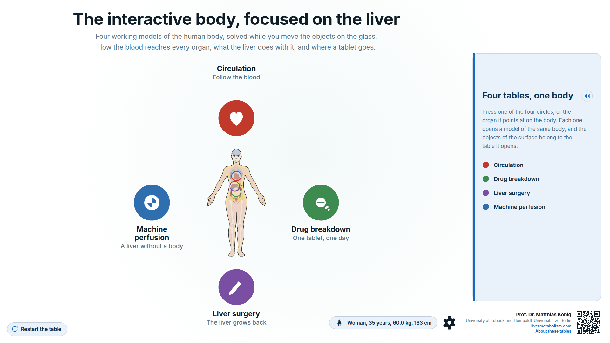
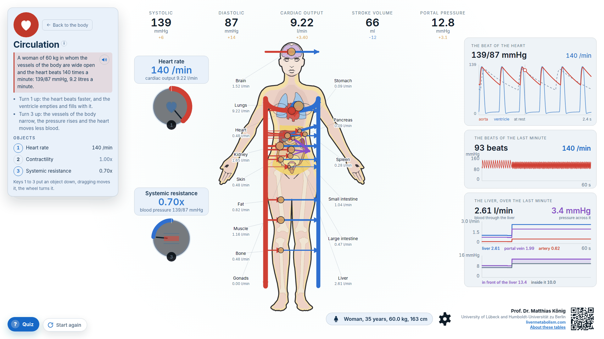

# pkpdsim-tui
[](https://github.com/matthiaskoenig/pkpdsim-tui/actions/workflows/ci.yml)
[](https://github.com/matthiaskoenig/pkpdsim-tui/actions/workflows/docs.yml)
[](https://matthiaskoenig.github.io/pkpdsim-tui)
[](https://tuio.org/)
[](https://opensource.org/license/MIT)

Four tables you can touch, built on the PBPK/PD models of [pkpdsim](https://github.com/matthiaskoenig/pkpdsim). Put a physical object on a multitouch table, turn it, and the model answers: the blood pressure changes, the liver grows back, the drug moves through the body. The input is [TUIO](https://tuio.org/), the protocol of tangible surfaces. A mouse works too, so everything runs on a laptop as well.



The tables are the circulation, liver surgery, a drug through the body, and a liver on a perfusion machine. Each speaks English, German and Spanish, at three levels, and reads itself aloud.



## Quick start

```bash
npm install
npm run sync          # copies the models and reference data of a pkpdsim checkout
npm run dev           # http://localhost:5173
```

That one port carries the application, the TUIO simulator at `/simulator/` and the tracker at `/tuio`. Use another port with `npm run dev -- --port 8080`.

## Documentation

[matthiaskoenig.github.io/pkpdsim-tui](https://matthiaskoenig.github.io/pkpdsim-tui) covers how to run it, the four tables, the simulator, a real table, the languages and the voice, and how the code is laid out.

## License

* Source code: [MIT](https://opensource.org/license/MIT)
* Documentation: [CC BY-SA 4.0](https://creativecommons.org/licenses/by-sa/4.0/)
* Models: the license of the model repository they come from

This program is distributed in the hope that it will be useful, but WITHOUT ANY WARRANTY; without even the implied warranty of MERCHANTABILITY or FITNESS FOR A PARTICULAR PURPOSE.

© 2026 [Matthias König](https://livermetabolism.com)
