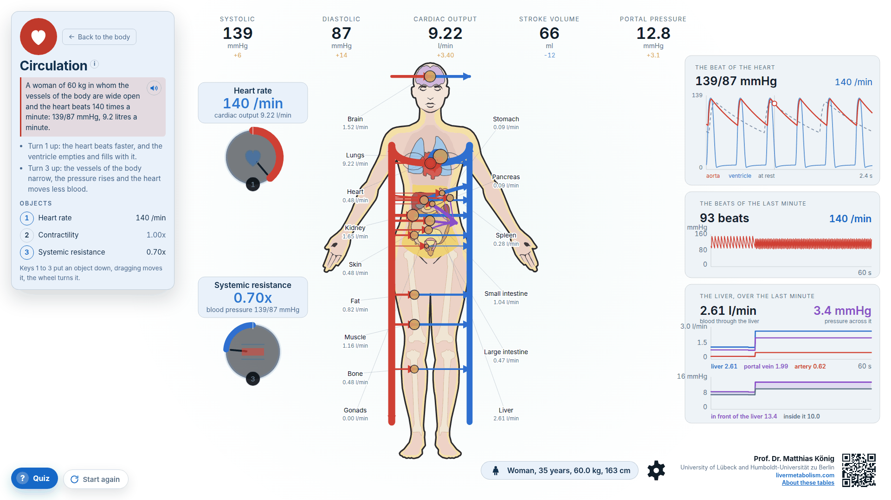

# Follow the blood

The whole circulation on the table, three objects that change it, and a heart that beats while they are being moved.



The model is the cardiovascular model of the pkpdsim PBPK library: a heart, a pulmonary circuit, fourteen systemic organs, and the portal system that drains five of them through the liver. Two of its solutions run side by side. The pressure network has an algebraic steady state, solved on every frame, so the organs follow a hand without a wait. The beating heart is the compiled SBML of the same model, integrated with SUNDIALS IDA in a Web Worker, and it is where the blood pressure, the cardiac output and the stroke volume come from.

## Background

A heart at rest pushes five to six litres of blood a minute through the body, about the whole blood volume every minute. It does that in beats: the left ventricle fills while it is relaxed, the valve to the aorta opens once the pressure inside it is higher, and in a fraction of a second it ejects some seventy millilitres. The pressure in the aorta rises to the systolic value with that ejection and falls back to the diastolic value while the heart fills again, which is the two numbers of a blood pressure cuff. The flow through an organ is the pressure across it divided by its resistance, so narrowing a vessel moves both the flow through it and the pressures around it, and the circulation settles somewhere new within a few beats.

The liver is the organ this model is most careful about, because it is fed twice: the hepatic artery brings it blood at arterial pressure, and the portal vein brings it everything that drained the stomach, the intestines, the spleen and the pancreas. When the way out of the liver narrows, which is what cirrhosis does, the blood backs up in front of it and the pressure in the portal vein rises. That is portal hypertension, the condition behind the varices and the ascites of a decompensated liver.

A circulation is also the base of every PBPK model: each organ receives a blood flow, and the concentration a drug reaches in the liver or the kidney depends on how much blood arrives there. The same cardiovascular model carries the flows of the models in [pkdb_models](https://github.com/matthiaskoenig/pkdb_models).

## The objects

| Marker | Object | What it changes | Range |
| --- | --- | --- | --- |
| 1 | Heart rate | How often the heart beats, which the compiled heart is solved with | 40 to 150 /min |
| 2 | Contractility | How hard the ventricles squeeze, where turning it down is a failing heart | 0.4x to 1.6x |
| 3 | Systemic resistance | The resistance of every systemic organ at once, the afterload of the heart | 0.5x to 2x |

Each object is a dial, wherever it is put: the heart itself on 1 and 2, the vessels of the whole body on 3. Pointing away from the visitor is the reference physiology, 75 beats a minute and 1.00x. The two resistances are logarithmic, because a resistance factor is a ratio; the heart rate is linear, because it is read off a scale in beats per minute. Lifting an object restores the reference.

Inside the ring of the resistance is a vessel whose opening narrows as the factor goes up, following Poiseuille's law, and inside the two of the heart is a heart beating at the rate of the dial. The heart and the resistance change both solutions at once: the body is solved at the pressure head that carries the cardiac output of the current beat, so a faster or harder beating heart raises the flow through every organ.

## What the table shows

Six numbers at the top, read off the beating heart over its last three beats. The small number under each one is the change against the reference heart of the same body.

| Number | What it is |
| --- | --- |
| Systolic | The highest pressure in the aorta during a beat, in mmHg |
| Diastolic | The lowest pressure between two beats, in mmHg |
| Cardiac output | The blood the heart moves, in l/min |
| Stroke volume | What one beat moves, the cardiac output divided by the rate, in ml |
| Portal pressure | The mean pressure in the portal vein, in mmHg |
| Portal gradient | Portal pressure minus the pressure in the liver, the number portal hypertension is measured by |

The body is drawn as large as the surface allows. Every vessel carries an arrow saying which way the blood runs and is as wide as the flow it carries: the arterial side red, the venous side blue, the portal system purple. Each organ is a disc as large as its flow, grey at the reference, blue when it has lost half of it, amber when it has gained half. The organ names stand in two columns clear of the body, the ones draining into the vena cava on the left, the portal ones on the right, each with the flow it is getting right now.

Three panels stand at the other edge:

- **The beat of the heart.** 2.4 seconds of the solved heart, the aorta in red and the left ventricle in blue, with a cursor walking through them in real time. Behind them, dashed, is the first heart solved on this table, so every later run is read against it. The window is a time and not a number of beats, so a fast heart visibly crowds its beats together.
- **The beats of the last minute.** The same pressure over sixty seconds, where one beat is four pixels wide. It answers how many beats that is, and counts them as they pass.
- **The liver, over the last minute.** The flow through the liver, split into the portal vein and the hepatic artery, and the two pressures with the shaded gap between them that is the portal gradient. Both scales start at zero and never fall under 2.5 l/min and 16 mmHg, so a quiet minute is a flat line.

A run of the heart takes about two seconds. While it is in flight the anatomy keeps answering, because the steady network is solved on every frame.

## Things to try

- **Vasodilation.** Turn object 3 to the left. Every organ gains flow, the cardiac output rises, and the monitor draws the liver filling up: from 1.8 to 3.4 litres a minute, and 10 to 15 mmHg in front of it.
- **A slow heart.** Turn object 1 down to 40 /min. One beat moves half as much again, but the output still falls and the pressure has further to fall between beats: about 107/41 mmHg.
- **A failing heart.** Turn object 2 down. The ventricle empties less with every beat and the circulation is carried by the rate alone.
- **A racing heart.** Turn object 1 up to 150 /min. The flow through every organ rises with it, the liver included.

## Where the numbers come from

The algebraic solution is a port of `cardiovascular-model.mjs` of the pkpdsim documentation, and its test holds it to the exported reference: the portal pressure, the pressure in the liver, the cardiac output and all fourteen organ flows, with both nodes conserving flow. The beating heart is a port of `cardiovascular-solver.mjs`, with the same request and the same intervention at the end of a whole beat; its test summarizes the beats pkpdsim published and requires the numbers that came with them. Where the table departs from the export it does so to stay quick under a hand: it reads the summarized beats at 2 ms instead of 0.2 ms, which moves every number by less than a tenth of its unit, and asks for eleven columns instead of thirty four.

The reference circulation, the organ resistances and the anatomy are generated in pkpdsim by `scripts/cardiovascular_examples.py` and copied in by `npm run sync`, which writes a `provenance.json` naming the commit they came from.

## Run it

```bash
npm run sync
npm run dev:cardiovascular
```

The table is the red disc on the body at `http://localhost:5173/`, and `?app=cardiovascular` opens it directly. `&tuio=/tuio` puts it on the tracker of the development server, `&tuio=host:port` on a [table](../table.md) somewhere else, and `&sex=female&age=35` picks who is at it.
