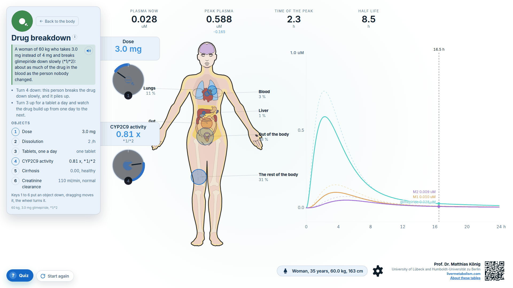

# One tablet, one day

One individual on the table, six objects that say who they are, and the body of that individual with the drug moving through it.



The model is the [glimepiride model](https://github.com/matthiaskoenig/glimepiride-model), a whole body PBPK model of the sulfonylurea glimepiride and of its two metabolites M1 and M2. A tablet is swallowed, the liver turns glimepiride into M1 with CYP2C9, M1 becomes M2, and the kidneys clear both into the urine. Every dial is one of the things that make two people respond differently to the same tablet.

## Background

Glimepiride is taken for type 2 diabetes: it makes the pancreas release insulin, which lowers the blood sugar. Too much of it lowers the blood sugar too far, and a hypoglycaemia in an elderly patient is a fall, a confusion or a hospital admission. The table asks the question of the prescription: the same tablet, in two different people, leaves how much drug in the blood?

A drug makes four steps, and one object stands at each of them. The stomach dissolves the tablet and the gut lets it through, which is the absorption. The blood carries it into organs of very different sizes, which is the distribution and which is why the body on the table is the body of a particular person. The liver takes it apart with CYP2C9 into M1, which is itself active, and then into M2, which is not. The kidneys wash both out in the urine.

CYP2C9 is the interesting one. About one person in eight carries a slow allele, and somebody with two of them breaks glimepiride down at roughly a quarter of the usual rate. They get a multiple of the exposure from the same tablet, and the guidance for them is a lower dose. A cirrhotic liver has less working tissue and less enzyme in it, so it acts in the same direction. Failing kidneys hold the metabolites back instead.

This is what a physiologically based model is for. It does not fit a curve to a population; it carries the organs, their blood flows and the enzyme in the liver, so each of these can be turned on its own and the answer follows from the physiology.

## The objects

| Marker | Object | What it changes | Range | Reference |
| --- | --- | --- | --- | --- |
| 1 | Dose | The tablet that is swallowed, in the strengths there are | 0.5 to 8 mg | The starting dose of this body weight |
| 2 | Dissolution | How fast the tablet dissolves in the stomach | 0.25 to 8 /h | 2 /h |
| 3 | Tablets, one a day | How many mornings in a row a tablet is taken | 1 to 10 | 1 |
| 4 | CYP2C9 activity | The activity of the enzyme that makes M1 | 0.23 to 1.00 | 1.00, which is `*1/*1` |
| 5 | Cirrhosis | How cirrhotic the liver is | 0 to 0.95 | 0, healthy |
| 6 | Creatinine clearance | What the kidneys still clear | 10 to 110 ml/min | 110 ml/min |

The dose clicks through the tablets that exist, 0.5, 1, 2, 3, 4, 6 and 8 mg, rather than through the milligrams between them. Where it rests is the dose a body of that weight is started on: the four milligrams of the label carried down with the weight and rounded to a tablet, so a child of twenty kilograms opens at one milligram. What a child is given is a decision of a doctor, and glimepiride is not a drug children are given at all; the dial says what the arithmetic of the body weight says.

Three dials say in words what they are set to, because that is how a clinician reads them: the CYP2C9 dial names the genotype it is nearest to (`*1/*1` through `*3/*3`, from the allele activities of the model's marimo application), the cirrhosis dial names the Child-Pugh class, and the kidney dial names the stage of impairment. Where the reference sits at one end of what is possible, as a creatinine clearance that cannot be better than normal does, the dial has half a span and the table draws only that half.

The tablets object is the course rather than a property of the person: one tablet every 24 hours, and the course runs to the end of the day of the last of them. One tablet is one day, which is the question this table asks. The table solves that course, and the clock then runs along it by itself, over and over, so the drug arrives and leaves without anything to wind.

Who the person is comes from the first screen and the settings in the far corner, not from an object. The organs, their blood flows, the volume the drug is distributed in and the dose the dial rests at all follow that body.

## What the table shows

The individual carries a bubble on every part of the body the model holds: the gut with the tablet that has not been taken up, the liver, the blood, the lungs, the kidneys, the rest of the body and what has left it. The area of a bubble is what that part holds, counted in millimoles of glimepiride and both metabolites together, because one molecule of the drug becomes one of M1 and then one of M2. The bubbles are the dose that was swallowed, wherever it has got to.

| Number | What it is |
| --- | --- |
| Plasma now | The plasma concentration of glimepiride at the hour the clock has reached, in uM |
| Peak plasma | The highest plasma concentration of the course |
| Time of the peak | When it is reached, in hours after the dose |
| Half life | The half life of the terminal part, from a straight line through its logarithm |
| Exposure | The area under the course that was simulated |
| M1 and M2 in urine | What has arrived in the urine at the end of the course, in umole |

The plot beside the body is the plasma course of glimepiride, M1 and M2. All three share one scale, so their heights can be compared, and the same individual at the reference is dashed behind them. The cursor walks along it, and the bubbles on the body are that same moment.

## Things to try

- **The poor metabolizer.** Turn the CYP2C9 dial down to `*3/*3`. Glimepiride is cleared more slowly, the peak and the exposure rise, the half life lengthens and less M1 and M2 reach the urine. The dose that is right for a wild type individual is too much for this one.
- **The cirrhotic liver.** Turn the cirrhosis dial to CPT C. The liver loses functional mass and perfusion at once, and the parent accumulates.
- **The failing kidney.** Turn the clearance dial down to severe. Glimepiride itself hardly notices, because it leaves through the liver, but M1 and M2 stay in the plasma.
- **Two things at once.** Put the poor metabolizer and the cirrhotic liver on the table together. This is the patient a label warns about.

## Where the numbers come from

The model is the SBML of its own repository, compiled here by `scripts/export_model.py` with the same release of sbmlsim-core that pkpdsim exports its examples with, and the compiled model travels with the release. [The resources of a release](../development.md#the-resources-of-a-release) is how it is written again.

The individual becomes five parameters of that model (`PODOSE_gli`, `LI__f_cyp2c9`, `f_cirrhosis`, `KI__f_renal_function`, `BW`), set before the initial values are resolved, because that is how an oral dose is given: the tablet is in the intestine when the clock starts. The creatinine clearance is the one control that is not a parameter; the model takes the fraction of the renal function that is left, and a clearance above the reference does not make the kidneys clear more than they can.

The pharmacokinetics are arithmetic on the solved course: the peak and its time are the largest value of the curve, the exposure is the trapezoid area under the simulated window rather than an extrapolation to infinity, and the half life is the slope of a straight line through the logarithm of its last third.

## Run it

```bash
npm run dev:glimepiride
```

The table is the green disc on the body at `http://localhost:5173/`, and `?app=glimepiride` opens it directly. `&tuio=/tuio` puts the page on the tracker of the development server, `&tuio=host:port` on a [table](../table.md) somewhere else, and `&sex=female&bw=60` picks who is at it.
