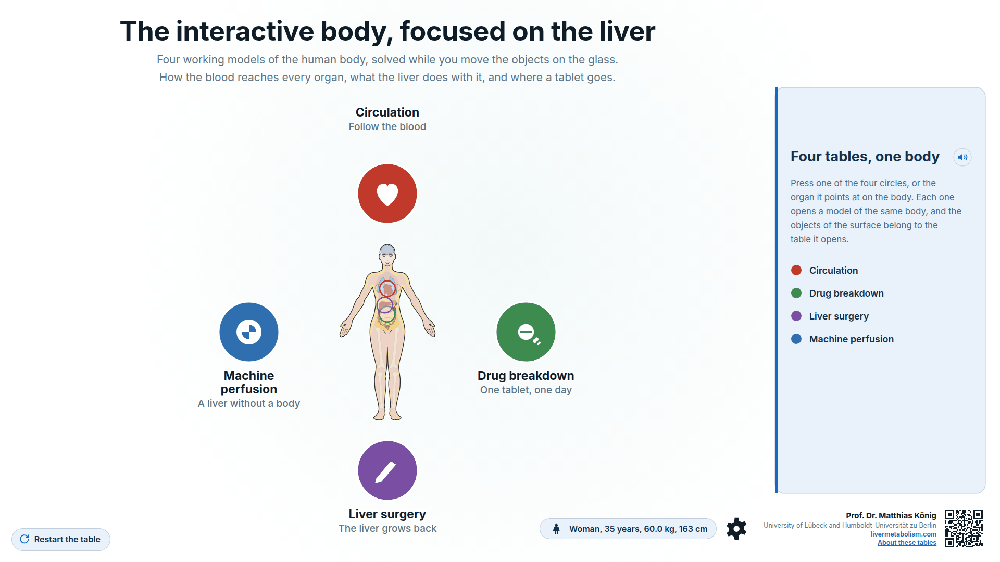
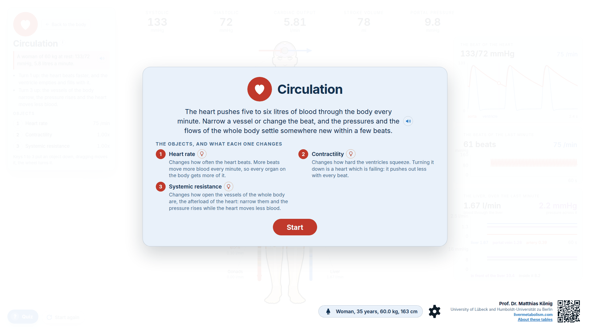

# The applications

Everything is one application. It opens on the body of the person at the table, with the four tables on a ring around it. Each is a disc in its own colour, which its organ on the body carries too. Touching a disc, or the organ it points at, opens that table; **Back** in the panel returns to the body.

| Table | What the objects do |
| --- | --- |
| [Follow the blood](cardiovascular.md) | The heart rate, how hard the heart squeezes, and how open the vessels are. The heart beats on the table while they are moved. |
| [The liver grows back](lobes.md) | One object turns through the resections a surgeon does, another says how fast the liver grows back. The days after the operation run by themselves. |
| [One tablet, one day](glimepiride.md) | The dose, the dissolution, the tablets a day, the CYP2C9 genotype, the liver and the kidneys of one person. |
| [A liver without a body](perfusion.md) | The pump, the oxygen and the temperature of a liver kept alive on a machine, and a dial through the hours. |

Each is opened from the body, or at once with its own `?app=`, which is in [the settings](#the-settings) below.

The three liver tables are one story: a liver that takes drugs apart, a liver that can be cut and grows back, and a liver that stays alive outside the body.

The vocabulary is the same everywhere, so a visitor who learned one table has learned the others.

- The marker of an object says **what it is**: a heart rate, a dose, a knife.
- Its angle says **which value it carries**. Pointing away from the visitor is the reference physiology, to the right is more, to the left is less.
- Its position says **what it acts on**, where that matters: the vessel, organ or lobe under it.
- Lifting the object **undoes** it. Nothing here is permanent.

## A visit

A visit begins before the landing page. The first screen asks which **language** to speak, with every language written in its own tongue; the second asks **who is looking**, a child, an adult or somebody of the field; the third asks **who is at the table**, the body every model is then solved for. All three answers go into the address, so a link that already says them walks straight in.

The landing page carries no panel: a heading, what the tables are for, the body of that person in the middle, and the four tables as coloured discs on a ring around it, each the same distance from the body and each in the colour of the organ it is about. The figure is that person and nobody else, at the height of that body and the width its weight makes. What a table is about stands in the sidebar at the right: the disc a hand is over, or an organ a finger is on, fills it with the whole of what that table shows, in the colour of that table. While nothing is chosen the sidebar is the key of the four colours.

The landing page reads no object at all. The objects belong to a table, which numbers them from 1, so one set of pucks serves every table and nothing has to be handed to a visitor who has just walked up.

## The settings

Who the tables are solved for stands beside the gear in the far corner, on every page: a line with the body, the age, the weight and the height, which opens the question again when it is pressed. It is the one setting a visitor changes while they are at a table.

Everything about the table itself waits behind the **gear** in that corner: which table is open, the language, the level, the body and the address of the tracker. They are rows of either-or switches drawn as pictograms and flags rather than words, because a visitor who cannot read the language is the one who needs the language switch. The choices hold while a visitor walks from one table to the next, and they travel in the address:

| In the address | What it says | What it takes |
| --- | --- | --- |
| `?app=` | Which table opens | `cardiovascular`, `lobes`, `glimepiride`, `perfusion`, `about`, or nothing for the body |
| `?lang=` | The language | `en`, `de`, `es`, or `auto` for the language of the browser |
| `?level=` | Who is looking | `child`, `adult`, `expert` |
| `?sex=` `?age=` `?bw=` `?height=` | Who is at the table | a body, years, kilograms, centimetres |

A page which is given neither language nor level opens in German, for a child, which is what the booth it was built for needs. A booth can be started on `?lang=es&level=child` and stay there. The tracker and the pucks of a table are not in this list, because they belong to the booth and are said once in the command which serves the pages; see [Run on a table](../table.md).

## The language and the level

The same table in three languages and at three levels. A table in a museum is walked up to by a six year old, by their parent and by a hepatologist, one after the other, and they are not owed the same sentence.

- **The language.** English, Deutsch, Español, each written in its own tongue and carrying its flag.
- **The level.** Kids, Adults, Experts: *explain it like I am six*, *explain it to an adult who knows nothing about this*, and *tell me what it really is*.

The level decides how much is said at all, and not only the words:

| | Kids | Adults | Experts |
| --- | --- | --- | --- |
| The title of a dial | *How fast the liver works* | *CYP2C9 activity* | *CYP2C9 activity* |
| What it is | "How quickly the liver takes the tablet apart. Some people are slow at it." | "The activity of CYP2C9, which makes M1 out of glimepiride. Turning it down is a poor metabolizer." | "The enzyme which hydroxylates glimepiride to M1. The detents are the \*1/\*1, \*1/\*2, \*1/\*3, \*2/\*3 and \*3/\*3 genotypes." |
| The numbers of the band | the two or three which answer the question | what a visitor asks next | all six |
| German and Spanish | du, tú | Sie, usted | Sie, usted |

A band of six numbers is not what a six year old came to read, so a number carries the level it appears from and the band is filtered by it. A table never shows a child something it cannot explain to them. The level a visitor chooses holds for every table until it is changed. How the words and the recorded clips are made is in [Languages and the voice](../languages.md).

## Who is at the table

A model of the body is a model of somebody, so the third question of the first screen asks who. Four answers on one screen: the **body**, a woman or a man, drawn rather than named; the **age**, from three to a hundred years; what that body **weighs**, from three to a hundred and fifty kilograms; and how **tall** it is, from fifty to two hundred and thirty centimetres.

The screen opens where the question before it points. A visitor who said a **child** is looking is shown a body of ten years, with the weight and the height of a body of ten; an adult and somebody of the field open at the reference adult of thirty-five. Asking a ten year old to drag the age down from thirty-five is asking them to answer the same question twice.

The three numbers are set one by one and none of them moves another, because the age, the weight and the height of a person are three measurements rather than one. Each line carries a mark at what is typical for the age that is currently set, so a visitor sees what a body of that age usually weighs without anything moving by itself. The lines are the one thing on these tables that is dragged rather than pressed.

What the answers do:

- The **age and the body** give the reference body of ICRP 89 (`children_human.toml` and `physiology_human.toml` of pkpdsim), interpolated in age the way the library interpolates it. That is where the weight and height lines open and what their marks stand at.
- The **weight and the height** are the `BW` and the `HEIGHT` of every model, which scales the organs, their blood volumes and their flows.
- The **years of an adult** carry the fall of the kidney function with them (`age_human.toml`, Delanaye 2022 and Eriksen 2020), so the creatinine clearance of the drug table opens where the years have left it.

What it is not: a model of a child. A three year old is not a small adult, and the enzymes of a child, the water in their tissues and the way they absorb a tablet are not those of a grown up. What the tables show at three years is the physiology of a body of that size, which is where a visitor starts to see why a child is given another dose. The drawing is the grown up anatomy either way, stretched to the height of this body and to the width its weight makes.

## Choosing, and going back

A table has no click, so everything that is pressed rather than turned is pressed by a finger: a disc on the landing page, the organ it points at, a switch in the panel, or **Back**, which every table carries above its title. Two gestures press one, and nobody has to be told which:

- **A tap.** A finger that lands on an element and goes again presses it when it goes, the way a phone answers.
- **A rest.** A finger that stays on an element presses it after a moment, and the element fills while the finger is there, so that holding is visibly doing something.

A finger that moves off the element before it goes presses nothing, and neither does a hand sweeping across the glass or one leaning on it: a press belongs to the element the finger landed on and left from. Everything a visitor can press is at least a fingertip across, because a visitor aims by eye across a table rather than with a pointer.

Touches do what touches are good at besides, such as scrubbing a time course or switching the table or the body.

## The page a table opens with

Every table opens with one page, in the words of the chosen level and in the colour of that table, so a visitor who pressed a red circle meets a red page: what this table is about in a sentence or two, then every object with what turning it changes. A speaker reads it aloud, and **Start** hands the surface over. The things worth trying belong to the panel, which stands beside the surface while they are being tried.

Beside each object is a **light bulb** for the visitor who wants more than how to turn it. It opens the physiology behind that object in the place of the list, one at a time, closed again from its own corner, so the page keeps its size and the way in is never pushed off the glass. That matters on a table that cannot scroll. The text is one piece of prose rather than one per level, because the depth is the point of asking for it; the line above it follows the level.

It is the same page on every table, built in `packages/tui-kit` out of what a table already tells its panel. Starting that table again brings the page back.

## What a visitor is told

Each table says the little that is needed at a glance and keeps the rest behind the thing it belongs to. Hovering a number, an object, an organ or a card with a mouse, or resting a finger on it, opens a note that says what it is: what a portal pressure means, what the object in somebody's hand does, how much blood an organ is getting.

The panel in the corner carries the title of the table and a sentence on the state the objects have put the body in, which changes as they move. The numbers at the edge are for whoever wants them, the sentence is for everybody else.

Inside the ring of an object is a picture of the thing it stands for, and the picture answers while the object is turned: a vessel narrows as its resistance goes up, a heart beats at the rate of the dial, a tablet fills, a clock hand walks through the days after an operation.

Every object that is turned wears a **band on its ring**, which is the change it is making. It grows out of the baseline of that object, the value the model has without it: the detent at the top of the dial for an object whose reference sits in the middle of its range, the end of the track for one whose reference is an end of it, like a liver that cannot be healthier than healthy. The band is red where the object was turned up and blue where it was turned down, and thicker the further it has been turned. An object nobody has moved wears none, so a table left alone says so from across the room.

Everything that is said can be **read aloud**. A speaker stands beside the sentence of the panel, inside every note, beside the sidebar of the landing page and beside the questions of the first screen. It reads in the language of the visitor, from the recorded clip where there is one and with the speech of the browser where there is not. See [Languages and the voice](../languages.md).

## The curves

A course drawn under a scene keeps the scale it opened with. Both ends are written at the side of the box, with the unit over them, and the scale only ever widens, when a curve leaves it. A plot whose axis follows what the numbers happen to be doing shows the same picture whatever the objects are set to, which is the opposite of what a visitor who just turned something wants to see.

What a course was before the objects were last moved stays behind it and fades, losing half of what is left every one and a half seconds, so the last few states are a trail in the direction the change went. The strip charts of the heart carry the same rule: their ceiling rises with what the table has shown and never falls again.

## Two surfaces

A visitor can tell from across the room what they are looking at. The **white canvas** is what is being shown: the body, the segments, the machine, the course of a curve. The **blue card** is what is being said: the panel, a note behind an element, the card beside an object. Everything that speaks is a pale blue card on the white canvas, the way a note in the margin of an atlas is. The dark is left to the furniture: the gear, the quiz and the ring of a tick.

Every table wears its own colour and its own picture over the title of its panel: the red heart of the circulation, the purple scalpel of the operations, the green tablet of the drug, the blue pump of the machine. **Back** stands in that row, and the **Quiz** and **Start again** of a table in the opposite corner: one row of furniture in each corner, and the rest of the glass for the body.

## The quiz

Every table carries three questions behind the **Quiz** button. A question has two or three answers, a visitor rests a finger on one, and the card says at once whether it was right, why, and what to turn at the table to see it happen. Nothing is lost by being wrong: the reason is the part worth remembering and it is shown either way. At the end the card says how many were right and offers the three again. The questions are in the `text.ts` of the table, in the three languages and in the same order, which a test insists on, so a visitor who switches language in the middle keeps their place.

## Starting again

**Start again**, beside the quiz in the corner of a table, resets that table: it loads once more at its reference state, with the page the table opens with up again. It is a reload and not an undo, which is what an exhibit between two visitors wants. It keeps the language, the level and the tracker, which belong to the booth, and the body, which belongs to the visitor standing there.

**Restart the table**, in the corner of the landing page, resets the visit: back to the first question, the language, the level and the body forgotten, the stars every quiz handed out cleared. It keeps nothing but the tracker the booth was set up with.

## The page about all of this

The laboratory is in the bottom right corner of every page, with the square a phone is pointed at, in the same place and at the same size, so a visitor can read whose work this is and take the address with them. The line under it opens one more page, which is not a table: **about**. It carries whose laboratory this is and how to reach it, which models the tables solve and where they come from, which software solves them, under which licences, and who paid for the work. Everything a licence asks to be said is there, including the anatomy, which is adapted from the EMBL-EBI Expression Atlas anatomograms under CC BY 4.0. A table carries none of it: the glass in front of an audience is for the body. The page is reached at `?app=about`.

## What runs the model

Nothing here solves a PBPK model of its own. The models, their compiled form, their runtime and their reference solutions are exported by pkpdsim and travel with the release, so what the table shows is what the SBML says. A model that lives in its own repository, like glimepiride, is compiled here by `scripts/export_model.py` with the same release of sbmlsim-core.

Two kinds of model meet on these tables. The steady pressure network of the circulation has an exact algebraic reduction, so the anatomy answers within a frame. The lobed liver and glimepiride are integrated with SUNDIALS IDA in a Web Worker on the compiled SBML: the objects stay where they are, the table says it is solving, and the answer replaces the one before it.
