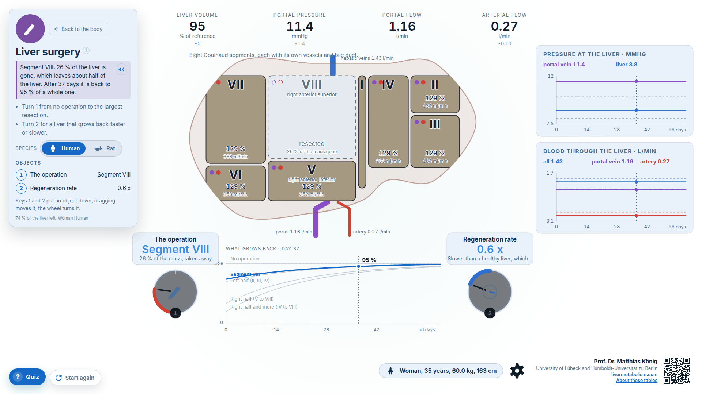

# The liver grows back

The liver divided into its segments, the operations a surgeon does on one object, and what grows back after each of them.



The model is the lobed liver of the pkpdsim PBPK library: each segment has its own portal branch, its own hepatic artery, its own volume and its own share of the drug that passes through. Taking a segment away is a resection, and the days that follow are the regeneration of what is left. The table solves that course with SUNDIALS IDA on the compiled SBML, in a Web Worker, every time the operation changes.

## Background

A liver is not one organ but eight pieces. Each Couinaud segment has its own branch of the portal vein, its own branch of the hepatic artery and its own way out into the hepatic veins, which is why a surgeon can take one away and leave the rest working. That is what makes a liver tumour operable: the piece that carries it is cut out, and what is left grows until it can do the work of the whole again. In a healthy person most of the mass is back within weeks, and the first days are the steep part of that curve.

The limit is how much liver is left. A remnant that is too small cannot keep up with what the body asks of it, and the blood the whole liver used to take now passes through a fraction of it, which raises the pressure in the portal vein. Surgeons therefore make the future remnant grow before they operate, by closing the portal branch of the side that will be removed.

The liver is also where most drugs are broken down, so the capacity left after an operation is the capacity that metabolizes them. The same model carries both, the mass of each piece and the drug that passes through it.

## The objects

| Marker | Object | What it does |
| --- | --- | --- |
| 1 | The operation | Turns through the resections a surgeon does, from the liver nobody touched to the largest one of the species |
| 2 | Regeneration rate | How fast what is left grows back, from a third of the rate of a healthy liver to three times it |

The panel also carries a switch a finger touches rather than an object: the species, the human liver or the rat one. The rat is on the human body only, because the female export is the human liver alone. The mouse is not offered, because its export carries the lobes but not the operations.

## The liver

The segments are drawn inside the silhouette of a liver, which is built from the blocks themselves and lies behind them in a warm, translucent tone, so that a mosaic of rectangles reads as the organ. The area of each block is its share of the mass, laid out as the body is seen from the front: the right lobe on the left of the picture, the caudate lobe as the strip in the middle, the left lobe on the right.

The blocks keep their place while the plan changes, because a physical object cannot move itself when the picture is redrawn. A segment that was taken away stays where it was, drawn hollow and dashed, and the loss of mass is read off the numbers. Each block says what became of it: the volume it has reached as a percentage of the same segment in a liver nobody operated on, and the flow through it. Two pips in its corner are its branches, filled while they are open. The colour follows the volume, blue where a segment has atrophied and amber where it has grown. Below the liver the portal vein and the hepatic artery come up to the hilum and the hepatic veins leave at the top, each as wide as the flow it carries.

## What the table shows

Four numbers at the top, read at the day the course has reached.

| Number | What it is |
| --- | --- |
| Liver volume | The volume of the whole liver, as a percentage of the reference liver |
| Portal pressure | The pressure in the portal vein, in mmHg |
| Portal flow | The flow through the portal vein, in l/min |
| Arterial flow | The flow through the hepatic artery, in l/min |

The small number under each one is the change against the same liver without the operation, at the same day. The course under the liver draws what grows back, with the untouched liver behind it as a dashed line. Two cards at the right draw the pressure and the flow over the same days, each with that untouched liver dashed behind it. The numbers at the top say where the liver stands; these say how it got there, which is the part of a resection a visitor cannot see on the organ.

## Things to try

- **Right hepatectomy.** Turn the knife to the right half. A third of the liver is left on the first day, the blood of the whole body passes through that third, and the portal pressure rises. Over the weeks that follow it grows back towards the volume of the whole.
- **The remnant too small.** Turn one further, to the extended right hepatectomy. The remnant starts far below what the body needs and the curve starts from further down.
- **A liver that is slow.** Turn the second object down. The same operation takes far longer to recover, which is what an ill liver does. The curve of a healthy one is still drawn behind it.
- **A rat is not a person.** Switch the species. The whole course is ten days rather than sixty, because a rat is most of the way back within a week.

## Where the numbers come from

The liver, its segments and their mass fractions, the compiled model and the solver settings are generated in pkpdsim by `scripts/lobes_examples.py` and travel with the release, beside a `provenance.json` naming the commit they came from. The states of a segment and the parameters each one writes (`g_po_<segment>`, `g_ha_<segment>`, `f_present_<segment>`) are a port of `lobes-model.mjs` of the pkpdsim documentation, and one run is a port of `lobes-solver.mjs`. Its test holds the port to the export: for every precomputed case, the operation has to produce exactly the parameter changes the export carries.

## Run it

```bash
npm run dev:lobes
```

The table is the purple disc on the body at `http://localhost:5173/`, and `?app=lobes` opens it directly. `&species=rat` opens the rat liver with its five lobes, `&tuio=/tuio` puts the page on the tracker of the development server, and `&tuio=host:port` on a [table](../table.md) somewhere else.
