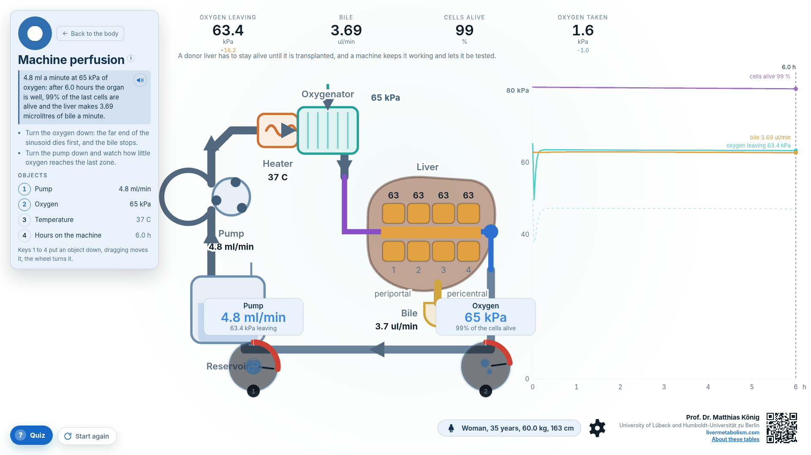

# A liver without a body

A liver outside a body, kept alive on a machine, and the three settings that decide whether it stays that way.



An organ taken out of a body dies unless something keeps feeding it. A perfusion machine does that: a pump pushes a fluid through it, an oxygenator puts the oxygen into that fluid, and the circuit is held at a temperature. This is how a donor liver is carried to a transplant and tested on the way, and how a liver is studied on its own in a laboratory. On this table the pump, the oxygen and the temperature are objects, and six hours of the perfusion are solved whenever they come to rest.

## Background

A liver in the body gets blood, which carries oxygen on haemoglobin. The perfusate of a machine has no red blood cells, so all of its oxygen is dissolved in the fluid and there is far less of it: what the oxygenator holds the fluid at, and how fast the pump moves it, is the whole supply. That makes the gradient along the sinusoid, which exists in every liver, easy to see and easy to break. The cells at the far end, the pericentral ones, are served last. When the supply is short they are the first to run out, the first to die and the first to release their enzymes into the fluid.

What is watched on a machine is what is watched in a patient: how much oxygen the organ takes, how much bile it makes, how much lactate it clears or produces, and how much ALT has leaked into the fluid. A liver that is doing well breathes, makes bile and eats lactate. One that is not makes lactate and lets its enzymes out.

Temperature decides how fast all of that happens. Warm, at 37 degrees, the organ works and has to be fed. Cold, at a few degrees, everything slows down, which is why a transplant organ is carried cold. Warm perfusion is what lets a surgeon see whether the organ works at all before it is used.

## The objects

| Marker | Object | What it does |
| --- | --- | --- |
| 1 | Pump | The flow through the organ, from 0.3 to 6 millilitres a minute |
| 2 | Oxygen | What the oxygenator holds the perfusate at, from 2 to 80 kPa |
| 3 | Temperature | The temperature of the circuit, from 4 to 37 degrees |
| 4 | Hours on the machine | Winds through the six hours of the perfusion, from the end back to the start |

The first three are absolute dials: the angle is the value, and lifting the object puts the machine back to its reference setting. The hour dial is relative, starts at the end of the run wherever it is put down and solves nothing, so it answers instantly.

The temperature is given to the model before the initial values are resolved, because the solubility of oxygen and the rates of the cells are initial assignments of it. Changing any setting therefore solves the whole perfusion again, which takes a moment, and the table says while it does.

## What the table shows

| Number | What it is |
| --- | --- |
| Oxygen taken | What the organ took out of the fluid on its way through, in kPa |
| Oxygen leaving | What is left in the fluid when it leaves the organ |
| Bile | What the organ makes, in microlitres a minute |
| Cells alive | The share of the cells at the far end of the sinusoid that are still alive |
| ALT released | The enzyme that only reaches the fluid when cells break open, in ukat/l |
| Lactate | The lactate in the perfusate, in mM |

The machine is drawn as the diagram of one, and it carries its own settings: the reservoir, the roller pump whose rollers turn at the rate it is set to, the heat exchanger, the membrane oxygenator with the gas line into it, and the organ hanging in the circuit. The flow, the temperature, the oxygen and the bile stand beside the part each belongs to, so the objects are read on the machine itself and not only in the panel.

Inside the organ is what the model solves: one sinusoid from the portal inlet to the central vein, with the hepatocytes along it in four zones, periportal at one end and perivenous at the other. Each zone carries the oxygen that reaches it and is coloured by it, and a zone whose cells are dying turns towards the colour of dead tissue. The course on the right draws the oxygen leaving, the bile and the cells alive over the six hours, each on a scale that does not move, so a flat line is a flat line.

## Things to try

- **Turn the oxygen down.** The last zone is starved first: its cells die, the bile falls and the ALT rises, while the first zone is still well. This is pericentral damage, the same pattern a liver shows after a long operation or a period without blood.
- **Turn the pump down.** Less fluid means less oxygen delivered, even at the same oxygen pressure, and the far end suffers in the same way.
- **Go cold.** At a few degrees the organ consumes almost nothing and makes almost no bile. It survives, but it is not working. That is the trade of cold storage.

## Where the numbers come from

The machine perfusion library of pkpdsim (`pkpdsim.perfusion`): a `PerfusionDefinition` of a rat liver with four zones in a normothermic circuit, built to flat SBML and compiled here with `scripts/export_model.py` and the same release of sbmlsim-core as every other table. No equation of the perfusion lives in this repository. [Development](../development.md) has the few lines of python that produce the model.

The organ is a rat liver, because that is the liver the parameter database of the perfusion library carries. The machine around it is the one that keeps human livers alive on the way to a transplant.

## Run it

```bash
npm run dev
```

The table is the blue disc on the body at `http://localhost:5173/`, and `?app=perfusion` opens it directly. `&tuio=/tuio` puts the page on the tracker of the development server, and `&tuio=host:port` on a [table](../table.md) somewhere else.
