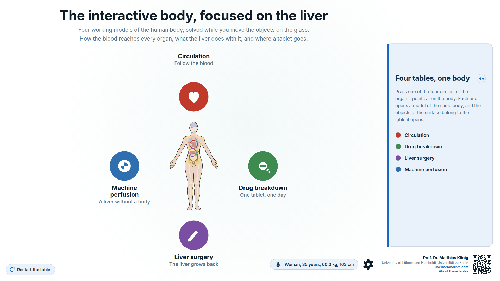
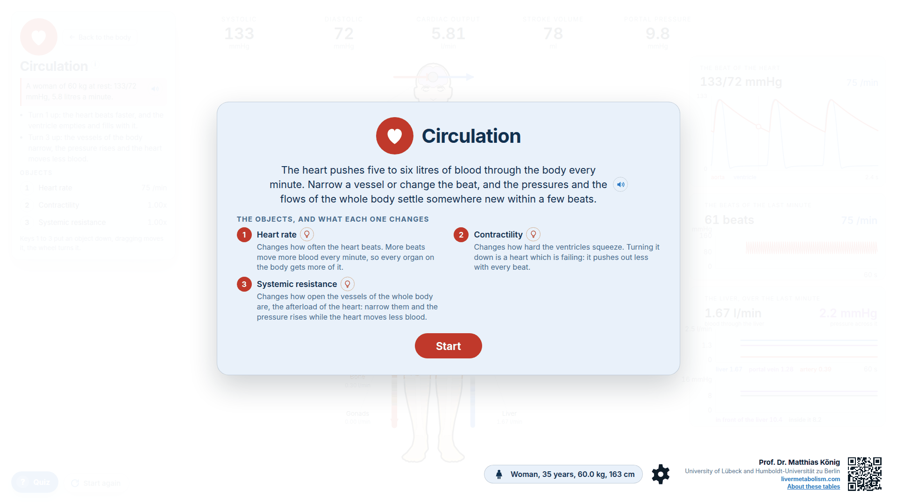

# pkpdsim-tui
[](https://github.com/matthiaskoenig/pkpdsim-tui/actions/workflows/ci.yml) [](https://github.com/matthiaskoenig/pkpdsim-tui/actions/workflows/docs.yml) [](https://matthiaskoenig.github.io/pkpdsim-tui) [](https://tuio.org/) [](https://opensource.org/license/MIT)

Four tables you can touch, built on the PBPK/PD models of [pkpdsim](https://github.com/matthiaskoenig/pkpdsim). A visitor puts a physical object on a multitouch table, turns it, and the model answers: the blood pressure changes, the liver grows back, the drug moves through the body. The input is [TUIO](tuio.md), which the tables of [Interactive Scape](https://www.interactive-scape.com/) and the [simulator](simulator.md) speak. A mouse works too, so everything also runs on a laptop.



## One application, four tables

Everything is one application. It opens on the body of the person at the table, with the four tables on a ring around it. Each table is a disc in its own colour, which its organ on the body carries too. Touching a disc, or the organ it points at, opens that table; **Back** in the panel returns to the body.

| Table | Opened by | What the objects do |
| --- | --- | --- |
| [Follow the blood](apps/cardiovascular.md) | `?app=cardiovascular` | The heart rate, how hard the heart squeezes, and how open the vessels are. The heart beats on the table while they are moved. |
| [The liver grows back](apps/lobes.md) | `?app=lobes` | One object turns through the resections a surgeon does, another says how fast the liver grows back. The days after the operation run by themselves. |
| [One tablet, one day](apps/glimepiride.md) | `?app=glimepiride` | The dose, the dissolution, the tablets a day, the CYP2C9 genotype, the liver and the kidneys of one person. |
| [A liver without a body](apps/perfusion.md) | `?app=perfusion` | The pump, the oxygen and the temperature of a liver kept alive on a machine, and a dial through the hours. |

The three liver tables are one story: a liver that takes drugs apart, a liver that can be cut and grows back, and a liver that stays alive outside the body.

Who the person is, their sex, their age from three to a hundred and twenty years, their weight and their height, is asked on the first screen, and every model is solved for them. The body holds when the visitor moves to the next table.

## Quick start

```bash
git clone https://github.com/matthiaskoenig/pkpdsim-tui.git
cd pkpdsim-tui
npm install
npm run sync                 # the models and reference data of a pkpdsim checkout
npm run export:glimepiride   # the glimepiride model, from its own checkout
npm run export:perfusion     # the machine perfusion model, built with pkpdsim
npm run dev
```

The exports are not in the repository, and each of the three commands writes the folder of its own tables, see [Development](development.md#commands). A table which finds no model says which command writes it, and `npm run sync` says what a pkpdsim checkout is missing when it is behind the export the tables ask for.

`npm run dev` starts the application and the [TUIO simulator](simulator.md) on one port. The application finds the tracker of that server by itself, so there is nothing to add to the address:

| Address | What it is |
| --- | --- |
| `http://localhost:5173/` | The body, from which every table is opened |
| `http://localhost:5173/?app=cardiovascular` | One table directly; `lobes`, `glimepiride` and `perfusion` are the others |
| `http://localhost:5173/?lang=de&level=child` | The same, in German and said the way a six year old is told it, see [Languages and the voice](languages.md) |
| `http://localhost:5173/simulator/` | The simulator, with the application under its own surface |
| `http://localhost:5173/?ids=1,3,5,6,11,12,21` | The ids the markers of a table carry, for a page which is not of a booth, see [Run on a table](table.md#the-ids-of-the-markers) |
| `http://localhost:5173/?tuio=10.0.0.20:3343` | The tracker of a real table, which the page then listens to alone |

Both the mouse and the objects work while `npm run dev` is running. The digit keys put an object down under the pointer, dragging moves it, the wheel turns it, backspace lifts it, and escape leaves a table for the body. `?tuio=off` keeps a page on the mouse alone, `?tuio=<host>:<port>` points it at a tracker somewhere else.

### Another port

`--port` moves the application, and the simulator has two ports of its own. A second copy beside a running one needs all three:

```bash
npm run dev -- --port 8080
npm run dev -- --port 8080 --page-port 3346 --tuio-port 3335
npm run dev -- --help
```

`--no-simulator` leaves the simulator out, for a real table or another tracker, and `--preview` serves the build instead of the development server. [Development](development.md) has the whole list.

### On a real table

The table is the tracker, and its markers carry their own ids. Both are said once, in the command of the table, and every page it serves is given them, so the address to open carries nothing:

```bash
npm run table
# then open http://localhost:5173/
```

It stands for `node scripts/dev.mjs --no-simulator --tuio 10.0.0.20:3343 --ids 1,3,5,6,11,12,21`, which is where the table of this exhibition is written down. See [Run on a table](table.md#start-it-on-a-table).

Because everything is on one port, a table on another machine is one forwarded port:

```bash
ssh -L 5173:localhost:5173 <machine>
```

## How a table works

The vocabulary is the same everywhere, so a visitor who learned one table has learned the others.

- The marker of an object says **what it is**: a heart rate, a dose, a knife.
- Its angle says **which value it carries**. Pointing away from the visitor is the reference physiology, to the right is more, to the left is less. A coloured band grows around the object as it moves away from the reference, red upwards and blue downwards.
- Its position says **what it acts on**, where that matters: the vessel, organ or lobe under it.
- Lifting the object **undoes** it. Nothing here is permanent.

A table has no click, so a touch chooses in the two ways a person tries: a tap, which presses when the finger goes, and a rest, which presses after a moment and fills the element while the finger is there. Touches do what touches are good at, such as scrubbing a time course or switching the table or the body.

Each table says in words what it is. The panel in the corner carries the title and a sentence on the state the objects have put the body in, which changes as they move. The numbers at the edge are for whoever wants them, the sentence is for everybody else. Everything else waits behind the thing it belongs to: hovering a number, an object or an organ with the mouse, or resting a finger on it, opens a note that says what it is.

Every word comes in three languages and at three levels: English, German and Spanish, for a child, for an adult who knows nothing about the subject, and for somebody who wants the mechanism. The level changes the numbers too, three at the edge for a child where an expert reads six. See [Languages and the voice](languages.md).

A table opens on a page that introduces its objects: what the table is about in a sentence or two, then every object with what turning it changes. A light bulb beside an object opens the physiology behind it for whoever wants more.



## What runs the model

Nothing here solves a PBPK model of its own. The models, their compiled form, their runtime and their reference solutions are exported by pkpdsim and copied in by `npm run sync`, so what the table shows is what the SBML says. A model that lives in its own repository, like glimepiride, is compiled here by `scripts/export_model.py` with the same release of sbmlsim-core.

Two kinds of model meet on these tables. The steady pressure network of the circulation has an exact algebraic reduction, so the anatomy answers within a frame. The lobed liver and glimepiride are integrated with SUNDIALS IDA in a Web Worker on the compiled SBML: the objects stay where they are, the table says it is solving, and the answer replaces the one before it.

## License

* Source code: [MIT](https://opensource.org/license/MIT)
* Documentation: [CC BY-SA 4.0](https://creativecommons.org/licenses/by-sa/4.0/)
* The anatomy is adapted from the [EMBL-EBI Expression Atlas anatomograms](https://github.com/ebi-gene-expression-group/anatomogram) under [CC BY 4.0](https://creativecommons.org/licenses/by/4.0/)

© 2026 [Matthias König](https://livermetabolism.com)
