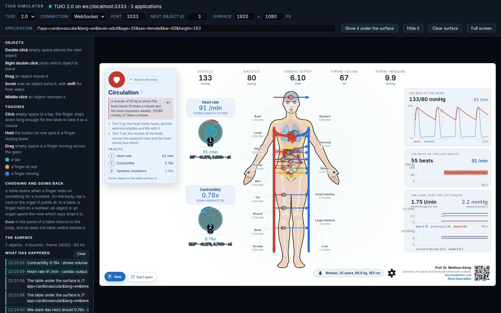

# Run the simulator

The simulator puts objects and touches on a surface you do not have to own. It is how these applications are built, and the first thing to reach for when a table misbehaves, because it says whether the table or the application is at fault.



## Run the table against it

```bash
npm install
npm run dev     # the simulator, and the table pointed at it
# then open http://localhost:3344/
```

The table and the simulator are two apps, so `npm run dev` starts one of each and tells each where the other is. The control page opens the table under its own surface, where an object placed on the surface sits on the picture it drives.

| Address | App | What it is |
| --- | --- | --- |
| `http://localhost:3344/` | simulator | The surface, with the table under it |
| `http://localhost:3344/?table=cardiovascular` | simulator | The same, opened on one table |
| `http://localhost:5173/` | table | The table in a window of its own, on the mouse and the keyboard |
| `ws://localhost:3333` | simulator | The tracker, which the table carries at `http://localhost:5173/tuio` |

The **Application** field above the surface takes any address, so the simulator drives an application somewhere else just as well. The embedded one gets no mouse: the surface over it owns the pointer, which is what a real table is like. To use a table with the mouse, open it in a window of its own, where the digit keys put an object down under the pointer, dragging moves it, the wheel turns it, backspace lifts it and escape leaves a table for the body.

`npm run simulator` starts the simulator alone, with `--table <url>` for the table it drives, `--port` for the tracker, `--page-port` for the page, and `--host`, `--tuio`, `--transport`, `--rate` and `--allow-origin` for the rest; they come after `--`, because npm takes the ones before it for itself. [Development](development.md#the-two-apps-and-their-flags) has the whole list of both apps. Two apps are two forwarded ports: `ssh -L 5173:localhost:5173 -L 3344:localhost:3344 <machine>`.

## Drive it

| Gesture | What happens |
| --- | --- |
| Click empty space | A tap: the touch stays down long enough for the table to take it as a choice |
| Press and hold empty space | A finger at rest, which is what presses a card or a switch on a table |
| Press and drag empty space | A finger moving across the glass |
| Double click, left button | Places an object carrying the **Next object id**, which then counts up |
| Double click, right button | Opens the picker, which places an object of any id |
| Press and drag on an object | Moves it |
| Scroll over an object | Turns it, five degrees at a time, or one with shift held |
| Middle click on an object | Lifts it off the surface |
| **Clear surface** | Lifts everything at once |
| **Full screen** | The surface alone, for a demonstration |

The three kinds of touch are three colours on the surface, teal, amber and blue, with a legend beside the gestures. Every object says what a tracker reports about it: its id, its angle, its position as surface fractions and its session id. With a table underneath, an object is not a numbered disc: the table says what it reads on it and the surface draws it, and an object whose number the open table does not read keeps a dashed amber ring, which is how a mislabelled puck is found without walking to the table.

The rail on the left keeps what happened, newest first, and on its own line what the table made of each change, which is the quickest way to see where a disagreement is. An object that was turned with no reading under it is a table that did not hear the tracker; a reading that does not move is a table that heard it and did not believe it.

## What it speaks

The **TUIO**, **Connection** and **Port** fields change the tracker while it runs, and it is replaced under the applications that are listening. A port that is taken changes nothing and says so in the chip, so a surface in front of an audience does not go down because somebody typed a port.

| Field | What it does |
| --- | --- |
| TUIO | **2.0** sends `/tuio2/frm`, `/tuio2/tok`, `/tuio2/ptr` and `/tuio2/alv`. **1.1** sends `/tuio/2Dobj` and `/tuio/2Dcur` instead |
| Connection | **WebSocket** listens, and is the only transport a browser can receive. **UDP** sends every frame to the port, as a tracker on a table does |
| Port | 3333, the port of TUIO, for both transports |

It sends a frame at the rate of the stream and at once when something moves, never reads anything from an application, and gives an application that connects in the middle the surface as it stands. One control page drives the surface at a time; a second takes it over and the first says so. The mobiles of the Unity simulator, the blobs of TUIO 1.1 and the bounds and symbols of TUIO 2.0 are not simulated.

Only a page of this machine may drive it, because the control socket decides what the table reads: a page served from somewhere else is turned away with a line in the log, and `--allow-origin http://table.local:5173` lets that one in. `npm run dev -- --host` passes `--allow-origin "*"` by itself. The simulator asks for no password, so `--host 0.0.0.0` on a network you do not trust hands it to everybody on that network.

## Point an application at a tracker

| What it says | Which tracker |
| --- | --- |
| `?tuio` | `ws://localhost:3333`, the simulator on this machine |
| `?tuio=host:port` | A tracker somewhere else, which is how a [table](table.md) is addressed |
| `?tuio=/tuio` | A tracker behind the server the page came from, which `npm run dev` arranges |
| `?tuio=ws://host:port/path` | A tracker named in full |
| `?tuio=off` | No tracker: the mouse alone, even where one answers |

`&tuio-version=1.1` asks for the older protocol, which the control page appends by itself. The panel in the corner of the table names the tracker and its state: a teal dot means bundles are arriving, amber that the socket is open and the first frame has not come, red that nothing is listening or that the tracker went away. A tracker found behind the server does not take the mouse away, so a table can be tried with one hand on the mouse while the simulator stands beside it; a tracker the address names is a real table, and there the page listens to the table alone.

## The simulator of Interactive Scape

The simulator a table comes with is [InteractiveScapeGmbH/tuio-simulator](https://github.com/InteractiveScapeGmbH/tuio-simulator), a Unity project which publishes no binaries: run a build you were given, or open the folder in Unity Hub, open the only scene and press play. Before pressing **Start**, set TUIO version **2.0**, connection type **WebSocket** and port **3333**; it is then a tracker on `ws://localhost:3333`, which a page reaches with `?tuio=localhost:3333`. A simulator on UDP is invisible to a browser whatever the port is.

Double clicking places a token, the **Next Object ID** field sets the marker it carries, dragging moves it and scrolling over it turns it. Any other TUIO tracker works too, as long as it offers the bundles over a WebSocket; [tuio.org](https://tuio.org/) lists them.

## When nothing arrives

1. Is the simulator **started**? The settings alone do nothing, and `npm run simulator` says where it is listening.
2. Is it on **WebSocket**? A simulator on UDP is invisible to a browser. Is the **version** the one the address asks for?
3. Do the **ports** match, in the simulator and in the address of the page? A port that is taken stops `npm run simulator` with the reason.
4. Is the browser on the **same machine**? If not, use the address of that machine, start the simulator with `--host 0.0.0.0` and `--allow-origin` for the page, and check that nothing blocks the port.
5. Open the developer console. A failed WebSocket says so there first.
